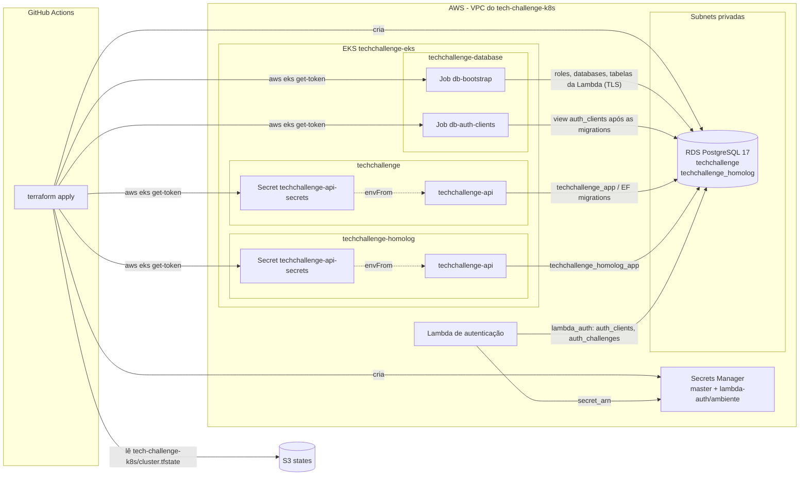

# tech-challenge-database

Infraestrutura do banco de dados gerenciado do Tech Challenge (FIAP Pós-Tech
13SOAT, Fase 3). O Terraform cria um Amazon RDS for PostgreSQL 17 na VPC do
`tech-challenge-k8s`, os segredos no Secrets Manager e, por Jobs no cluster
EKS, as roles, os databases de homologação e produção, as estruturas da
autenticação de clientes e o Secret consumido pela API.

Repositórios da solução:

| Repositório | Responsabilidade |
| --- | --- |
| `tech-challenge-k8s` | VPC, EKS, ECR, security groups, Argo CD e plataforma |
| `tech-challenge-database` (este) | RDS PostgreSQL, Secrets Manager, bootstrap do banco e Secret da API |
| `tech-challenge-lambda` | Function serverless que autentica o cliente por CPF e emite o JWT |
| `tech-challenge-application` | API .NET, migrations do EF Core e overlays Kustomize |

## Tecnologias

- Terraform >= 1.11 (backend S3 com `use_lockfile`), providers `aws`, `kubernetes`, `random` e `tls`
- Amazon RDS for PostgreSQL 17 (`db.t3.micro`, 20 GB gp2, Single-AZ, backups de 7 dias, TLS obrigatório)
- AWS Secrets Manager (senha master e segredo da Lambda por ambiente)
- Kubernetes Jobs com `psql` (bootstrap dentro da VPC) e Secrets da API
- PostgreSQL 17 em StatefulSet no kind (ambiente local, sem AWS)
- GitHub Actions

## Arquitetura



O RDS só aceita conexões (5432) do security group do cluster e do security
group da Lambda, ambos criados pelo `tech-challenge-k8s`. O bootstrap roda
dentro do cluster porque o runner do GitHub não alcança as subnets privadas
([ADR 0003](docs/adr/0003-bootstrap-job-no-cluster.md)).

## Estrutura

```text
terraform/
  database/            # AWS: RDS, parameter group, Secrets Manager e bootstrap no EKS
    certs/             # bundle global de CAs do RDS (verify-full dos Jobs)
  local/               # kind: PostgreSQL 17 com TLS no lugar do RDS, mesmo bootstrap
  modules/bootstrap/   # Jobs, scripts SQL e Secrets da API (usado pelas duas raízes)
    scripts/           # SQL idempotente executado pelos Jobs
docs/
  justificativa-banco.md  # por que PostgreSQL no RDS
  modelo-de-dados.md      # diagrama ER, relacionamentos e ajustes da Fase 3
  adr/                    # decisões de arquitetura
```

## O que é criado

| Recurso | Detalhe |
| --- | --- |
| `aws_db_instance.this` | `techchallenge-postgres`, PostgreSQL 17, `db.t3.micro`, 20 GB gp2 criptografado, privado, sem Multi-AZ, backups de 7 dias |
| `aws_db_parameter_group.this` | `postgres17` com `rds.force_ssl = 1` |
| `aws_db_subnet_group.this` | Subnets privadas do `tech-challenge-k8s` |
| Secret `techchallenge/database/master` | Usuário e senha master (aleatória) |
| Secret `techchallenge/lambda-auth/<ambiente>` | `database_connection` da Lambda (`SSL Mode=VerifyFull`); `private_key` e `otp_secret` vazios |
| Namespace `techchallenge-database` | Jobs `db-bootstrap` e `db-auth-clients` e as credenciais deles |
| Secret `techchallenge-api-secrets` | Em `techchallenge` e `techchallenge-homolog` |

Databases e roles (um database por ambiente, [ADR 0002](docs/adr/0002-instancia-unica-database-por-ambiente.md)):

| Ambiente | Namespace | Database | Role da API | Role da Lambda |
| --- | --- | --- | --- | --- |
| produção | `techchallenge` | `techchallenge` | `techchallenge_app` | `lambda_auth` |
| homologação | `techchallenge-homolog` | `techchallenge_homolog` | `techchallenge_homolog_app` | `lambda_auth_homolog` |

Chaves do Secret `techchallenge-api-secrets` (valores aleatórios por ambiente,
gerados com `random_password`):

| Chave | Valor |
| --- | --- |
| `ConnectionStrings__DefaultConnection` | `Host=<rds>;Port=5432;Database=<database>;Username=<role da API>;Password=...;SSL Mode=Require` |
| `ApprovalLinks__SigningKey` | 64 caracteres |
| `Jwt__LocalSigningKey` | 64 caracteres; assina os tokens de funcionários do login da API |
| `IntegracaoExterna__ApiKey` | 40 caracteres |
| `Seed__AdminPassword` | senha do usuário `admin` criado pelo seed da API |
| `Smtp__Host` / `Smtp__Port` | `mailpit` / `1025` (Mailpit de cada namespace) |
| `Smtp__Username` / `Smtp__Password` | aleatórios (o Mailpit aceita qualquer credencial) |

A API usa `SSL Mode=Require`: a conexão é criptografada e o RDS recusa conexões
sem TLS, mas a imagem da API não traz a CA da AWS para validar o certificado.
Os Jobs e a Lambda validam (`verify-full`/`VerifyFull`).

## Ordem com os outros repositórios

1. `tech-challenge-k8s`: VPC, EKS, security groups e Argo CD.
2. Este repositório: RDS, Secrets, `db-bootstrap` (roles, databases e tabelas
   da Lambda) e o Secret da API. O apply espera o `db-bootstrap`.
3. Argo CD sobe a API (tag no overlay do `tech-challenge-application`); a API
   aplica as migrations do EF Core no startup.
4. O Job `db-auth-clients` (criado no passo 2) detecta a migration e cria a view
   `auth_clients`, em até 60 minutos.
5. `tech-challenge-lambda`: `secret_arn` = output `lambda_secret_arns`, depois de
   preencher `private_key` e `otp_secret` no secret (abaixo).

Para destruir, a ordem é a inversa: este repositório antes do
`tech-challenge-k8s` (o destroy daqui remove recursos do cluster).

## Deploy no AWS Academy

### Configuração no GitHub (uma vez)

Mesmos secrets e variáveis do `tech-challenge-k8s` (se estiverem na
organização, não há nada a fazer):

| Tipo | Nome | Valor |
| --- | --- | --- |
| Secret | `AWS_ACCESS_KEY_ID` | sessão atual do Learner Lab |
| Secret | `AWS_SECRET_ACCESS_KEY` | sessão atual do Learner Lab |
| Secret | `AWS_SESSION_TOKEN` | sessão atual do Learner Lab |
| Variable | `AWS_DEPLOY_ENABLED` | `true` (sem ela só roda o CI, sem plan/apply) |
| Variable (opcional) | `AWS_REGION` | padrão `us-east-1` |
| Variable (opcional) | `TF_STATE_BUCKET` | padrão `techchallenge-tfstate-<account-id>` (o mesmo do `tech-challenge-k8s`) |
| Variable (opcional) | `AWS_DEPLOY_ROLE_ARN` | role OIDC fora do Academy; substitui as chaves |

As chaves do Academy expiram em 4 horas; o README do `tech-challenge-k8s`
mostra como atualizá-las com `gh secret set`. Todas as variáveis do Terraform
estão em [terraform/database/terraform.tfvars.example](terraform/database/terraform.tfvars.example).

### Pipeline (`.github/workflows/terraform.yml`)

| Evento | O que roda |
| --- | --- |
| PR para `develop` ou `main` | `terraform fmt`, `validate`, `tflint`, `terraform test` (providers simulados), `shellcheck` dos scripts e `terraform plan` |
| Push em `main` (merge do PR) | `terraform apply` (environment `production`) |
| Manual (*Run workflow*) | `apply` ou `destroy` |

Sem `AWS_DEPLOY_ENABLED=true` (ou com os secrets ainda com placeholders) só o
job de validação roda; ele não usa AWS.

### Manual (sem pipeline)

```bash
cd terraform/database
terraform init -backend-config="bucket=techchallenge-tfstate-$(aws sts get-caller-identity --query Account --output text)"
terraform apply
```

O RDS leva cerca de 10 minutos para ficar disponível. Acompanhar o bootstrap:

```bash
aws eks update-kubeconfig --region us-east-1 --name techchallenge-eks
kubectl -n techchallenge-database get jobs
kubectl -n techchallenge-database logs job/db-bootstrap
kubectl -n techchallenge-database logs -f job/db-auth-clients
```

Se a API demorar mais de 60 minutos para aplicar as migrations, recrie o Job
da view:

```bash
terraform apply -replace=module.bootstrap.kubernetes_job_v1.auth_clients
```

### Secret da Lambda

O Terraform grava só a `database_connection`. Quem implanta a Lambda completa
o secret de cada ambiente (o Terraform ignora mudanças posteriores no conteúdo):

```bash
arn=$(terraform -chdir=terraform/database output -json lambda_secret_arns | jq -r .production)
aws secretsmanager get-secret-value --secret-id "$arn" --query SecretString --output text \
  | jq --rawfile key private-key.pem --arg otp "$(openssl rand -hex 32)" '.private_key = $key | .otp_secret = $otp' \
  | aws secretsmanager put-secret-value --secret-id "$arn" --secret-string file:///dev/stdin
```

Se o endpoint do RDS mudar (instância recriada), recrie a versão do secret com
`terraform apply -replace='aws_secretsmanager_secret_version.lambda["production"]'`
e preencha as chaves de novo.

### Acesso

```bash
# Senha do admin da API (usuário admin) em produção
kubectl -n techchallenge get secret techchallenge-api-secrets -o jsonpath='{.data.Seed__AdminPassword}' | base64 -d

# Usuário master
aws secretsmanager get-secret-value --secret-id techchallenge/database/master --query SecretString --output text
```

## Ambiente local (kind)

Usa o cluster kind do `tech-challenge-k8s/terraform/local` (mesmo kubeconfig,
mesmos namespaces). No lugar do RDS sobe um PostgreSQL 17 em StatefulSet com
TLS obrigatório (certificado autoassinado) e um administrador sem
superusuário, com as mesmas restrições do master do RDS. Os Jobs e os Secrets
são os mesmos da AWS.

```bash
# Pré-requisito: cluster kind do tech-challenge-k8s (repositórios lado a lado)
cd ../tech-challenge-k8s/terraform/local && terraform apply

cd ../../../tech-challenge-database/terraform/local
terraform init
terraform apply
export KUBECONFIG=$PWD/../../../tech-challenge-k8s/terraform/local/kubeconfig
kubectl -n techchallenge-database get jobs
```

Outro caminho para o kubeconfig: `-var kubeconfig_path=...`. Com a API rodando
nos namespaces `techchallenge` ou `techchallenge-homolog`, o Job
`db-auth-clients` cria a view assim que as migrations terminam. Para conferir:

```bash
kubectl -n techchallenge-database exec postgres-0 -- psql -U postgres -d techchallenge -c 'SELECT * FROM auth_clients'
```

Para remover: `terraform destroy`.

## Integração com os outros repositórios

Entradas (state `tech-challenge-k8s/cluster.tfstate`): `vpc_id`,
`private_subnet_ids`, `database_security_group_id`, `cluster_name`.

Saídas de `terraform/database` (state `tech-challenge-database/database.tfstate`):

| Output | Uso |
| --- | --- |
| `endpoint`, `address`, `port` | Endereço do RDS |
| `databases` | Database e roles de cada ambiente |
| `lambda_secret_arns` | `secret_arn` da Lambda em cada ambiente |
| `master_secret_arn` | Secret do usuário master |
| `api_secrets` | Secret da API em cada namespace |

Contrato com a Lambda: view `auth_clients` (`id`, `cpf`, `active`, `email`),
tabelas `auth_challenges` e `auth_rate_limits` e os grants da documentação da
Lambda. Detalhes em [docs/modelo-de-dados.md](docs/modelo-de-dados.md).

## Documentação

- [Justificativa: PostgreSQL no Amazon RDS](docs/justificativa-banco.md)
- [Modelo de dados: diagrama ER, relacionamentos e ajustes da Fase 3](docs/modelo-de-dados.md)
- [ADR 0001 — PostgreSQL gerenciado no Amazon RDS](docs/adr/0001-postgresql-rds.md)
- [ADR 0002 — Uma instância RDS com um database por ambiente](docs/adr/0002-instancia-unica-database-por-ambiente.md)
- [ADR 0003 — Bootstrap do banco por Jobs no cluster EKS](docs/adr/0003-bootstrap-job-no-cluster.md)
