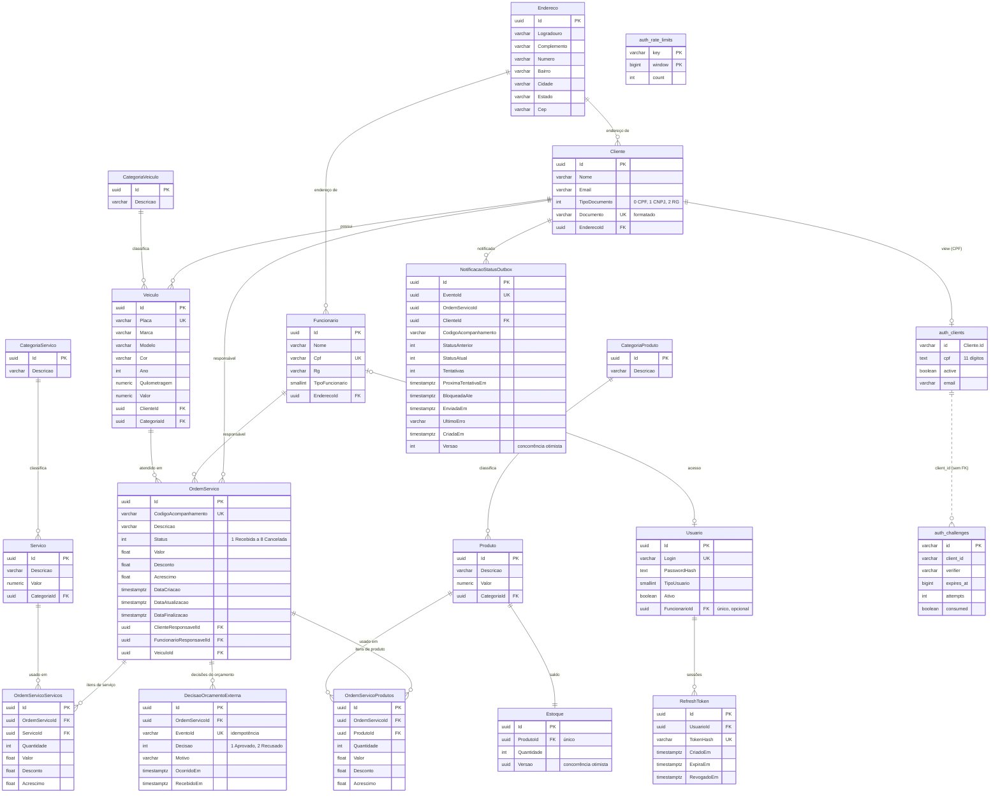

# Modelo de dados

O schema da oficina pertence à API (`tech-challenge-application`) e é criado
pelas migrations do EF Core em
`src/TechChallenge.Infrastructure.Database/Migrations`, aplicadas no startup
da API. O diagrama abaixo foi derivado do `ApplicationDbContextModelSnapshot`
(última migration: `20260901130148_AddExternalDecisionAndStatusNotifications`).
Este repositório não altera tabelas da API: ele só acrescenta as estruturas da
autenticação de clientes (seção [Ajustes para a Fase 3](#ajustes-para-a-fase-3)).

Cada ambiente tem o próprio database com o mesmo schema: `techchallenge`
(produção) e `techchallenge_homolog` (homologação).

## Diagrama ER



## Relacionamentos

| Relação | Cardinalidade | Regra de exclusão | Observação |
| --- | --- | --- | --- |
| `Endereco` → `Cliente`, `Funcionario` | 1:N | Restrict | O endereço é uma entidade própria; cliente e funcionário apontam para ele. |
| `Cliente` → `Veiculo` | 1:N | Restrict | Um cliente pode ter vários veículos; a placa é única. |
| `CategoriaVeiculo` → `Veiculo` | 1:N | Restrict | Categorias são cadastros de apoio. |
| `Cliente`, `Funcionario`, `Veiculo` → `OrdemServico` | 1:N | Restrict | A OS registra o cliente responsável, o funcionário responsável e o veículo atendido. Nenhum deles pode ser excluído com OS associada. |
| `OrdemServico` → `OrdemServicoServicos`, `OrdemServicoProdutos` | 1:N | Cascade | Itens do orçamento; são removidos com a OS. Valor, desconto e acréscimo ficam no item (preço no momento do orçamento). |
| `Servico` → `OrdemServicoServicos`, `Produto` → `OrdemServicoProdutos` | 1:N | Restrict | Catálogo de serviços e peças; não pode ser excluído se usado em uma OS. |
| `CategoriaServico` → `Servico`, `CategoriaProduto` → `Produto` | 1:N | Restrict | Classificação do catálogo. |
| `Produto` → `Estoque` | 1:1 | Restrict | Saldo de peças por produto (`ProdutoId` único) com token de concorrência `Versao`, para que duas OS não baixem o mesmo saldo ao mesmo tempo. |
| `OrdemServico` → `DecisaoOrcamentoExterna` | 1:N | Cascade | Aprovação/recusa do orçamento recebida pelo link ou pela integração externa; `EventoId` único garante idempotência do callback. |
| `Funcionario` → `Usuario` | 1:0..1 | Sem ação | Login dos funcionários; `FuncionarioId` é opcional e único (o admin do seed não tem funcionário). |
| `Usuario` → `RefreshToken` | 1:N | Cascade | Sessões do login de funcionários; só o hash do token é guardado. |
| `Cliente` → `NotificacaoStatusOutbox` | 1:N | Restrict | Outbox das notificações de mudança de status da OS. `OrdemServicoId` não tem FK: o evento sobrevive à OS. Índice composto (`EnviadaEm`, `ProximaTentativaEm`, `BloqueadaAte`) para o worker buscar pendentes. |
| `Cliente` → `auth_clients` | 1:0..1 | — | View: só clientes com CPF aparecem. |
| `auth_clients` → `auth_challenges` | 1:N | — | `client_id` sem FK (contrato da Lambda: sem dependência de uma view de outro time). |

Índices únicos da API: `Cliente.Documento`, `Funcionario.Cpf`, `Usuario.Login`,
`Usuario.FuncionarioId`, `Veiculo.Placa`, `OrdemServico.CodigoAcompanhamento`,
`Estoque.ProdutoId`, `RefreshToken.TokenHash`, `DecisaoOrcamentoExterna.EventoId`
e `NotificacaoStatusOutbox.EventoId`. Todas as FKs têm índice.

## Ajustes para a Fase 3

A Fase 3 acrescenta a autenticação de clientes por CPF numa Lambda
(`tech-challenge-lambda`, contrato em `docs/integration.md` daquele repositório).
A Lambda não conhece as tabelas da API: ela lê a view `auth_clients` e grava o
próprio estado em duas tabelas. Os ajustes são feitos pelos Jobs de bootstrap
deste repositório ([ADR 0003](adr/0003-bootstrap-job-no-cluster.md)), dentro de
cada database, e pertencem à role da aplicação do ambiente.

### Tabelas de estado da Lambda

[002-auth-state.sql](../terraform/modules/bootstrap/scripts/002-auth-state.sql)
(cópia do arquivo da Lambda), aplicado pelo Job `db-bootstrap`:

- `auth_challenges`: desafio OTP em andamento (`verifier` é o hash do código,
  `expires_at` em epoch UTC, `attempts` e `consumed` para limitar tentativas).
  Índice `ix_auth_challenges_expires_at` para a limpeza dos expirados.
- `auth_rate_limits`: contadores por janela fixa (`key` é um HMAC do CPF ou do
  IP, sem dado pessoal). Chave primária (`key`, `window`) para o
  `INSERT ... ON CONFLICT` atômico.

### View `auth_clients`

[004-auth-clients.sql](../terraform/modules/bootstrap/scripts/004-auth-clients.sql),
aplicado pelo Job `db-auth-clients`:

```sql
CREATE OR REPLACE VIEW auth_clients AS
SELECT
  c."Id"::varchar(36)                          AS id,
  regexp_replace(c."Documento", '\D', '', 'g') AS cpf,
  true                                         AS active,
  c."Email"                                    AS email
FROM "Cliente" c
WHERE c."TipoDocumento" = 0
  AND length(regexp_replace(c."Documento", '\D', '', 'g')) = 11;
```

- Só clientes com `TipoDocumento = 0` (CPF). Clientes CNPJ ou RG não fazem
  login pela Lambda.
- A API grava o CPF formatado (`123.456.789-09`); a view devolve só os 11
  dígitos, que é o que a Lambda recebe no login.
- `active` é sempre `true`: a API não tem status de cliente. Quando ela ganhar
  um, a view passa a usá-lo.
- `email` é o do cadastro. A API não tem verificação de e-mail; o grupo aceita
  o e-mail cadastrado na oficina como contato verificado.
- `created_at`/`updated_at` do modelo local da Lambda não existem na API e a
  Lambda não os consulta; ficaram de fora.

### Índice do CPF normalizado

```sql
CREATE UNIQUE INDEX "IX_Cliente_CpfNormalizado"
  ON "Cliente" ((regexp_replace("Documento", '\D', '', 'g')))
  WHERE "TipoDocumento" = 0;
```

Mesma expressão e mesmo filtro da view, então `WHERE cpf = $1` vira um *index
scan* (conferido com `EXPLAIN` no kind). É único porque o contrato da Lambda
exige CPF único; o índice único de `Documento` já garante isso para documentos
formatados pela API, este garante também para os dígitos.

### Privilégios

| Role | Database | Privilégios |
| --- | --- | --- |
| `techchallenge_admin` (master do RDS) | todos | Cria roles e databases; `CONNECT`/`TEMPORARY` nos databases e `SET ROLE` para a role da aplicação, sem herdar os privilégios dela. Usado só pelos Jobs. |
| `techchallenge_app` / `techchallenge_homolog_app` | o do ambiente | Dona do database e de todas as tabelas (migrations do EF Core, view, índice e tabelas da Lambda). |
| `lambda_auth` / `lambda_auth_homolog` | o do ambiente | `CONNECT`, `USAGE` em `public`, `SELECT` em `auth_clients`, `SELECT, INSERT, UPDATE, DELETE` em `auth_challenges` e `auth_rate_limits`. Sem acesso às tabelas da API nem DDL. |

`CONNECT` foi revogado de `PUBLIC` em cada database: as roles de um ambiente
não conectam no database do outro.

### Ordem de criação

1. `terraform apply` deste repositório: o Job `db-bootstrap` cria roles,
   databases, tabelas da Lambda e grants; depois o Terraform cria o Secret
   `techchallenge-api-secrets` nos dois namespaces.
2. A API sobe (Argo CD) com o Secret e aplica as migrations do EF Core.
3. O Job `db-auth-clients`, criado no mesmo apply, espera a migration
   `20260629015755_UseSingleClienteDocumento` (a que deixou `Documento` e
   `TipoDocumento` no formato atual) aparecer em `__EFMigrationsHistory` de
   cada database e cria o índice, a view e o grant. O apply não espera por ele;
   o prazo é de 60 minutos (`auth_clients_wait_minutes`).

Se a API não subir dentro do prazo, o Job termina com falha e basta recriá-lo:

```bash
terraform apply -replace=module.bootstrap.kubernetes_job_v1.auth_clients
```

Uma migration futura que altere ou remova `Cliente.Documento`,
`Cliente.TipoDocumento` ou `Cliente.Email` falha enquanto a view existir (o
PostgreSQL não altera colunas usadas por views). Nesse caso a migration deve
começar com `DROP VIEW IF EXISTS auth_clients` e o Job `db-auth-clients` deve
ser recriado depois do deploy, com a view ajustada se preciso.
